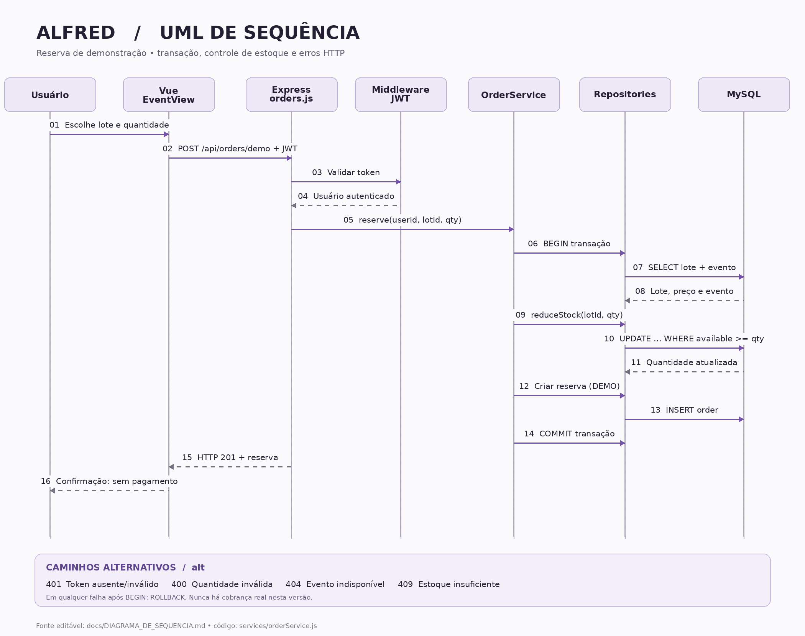
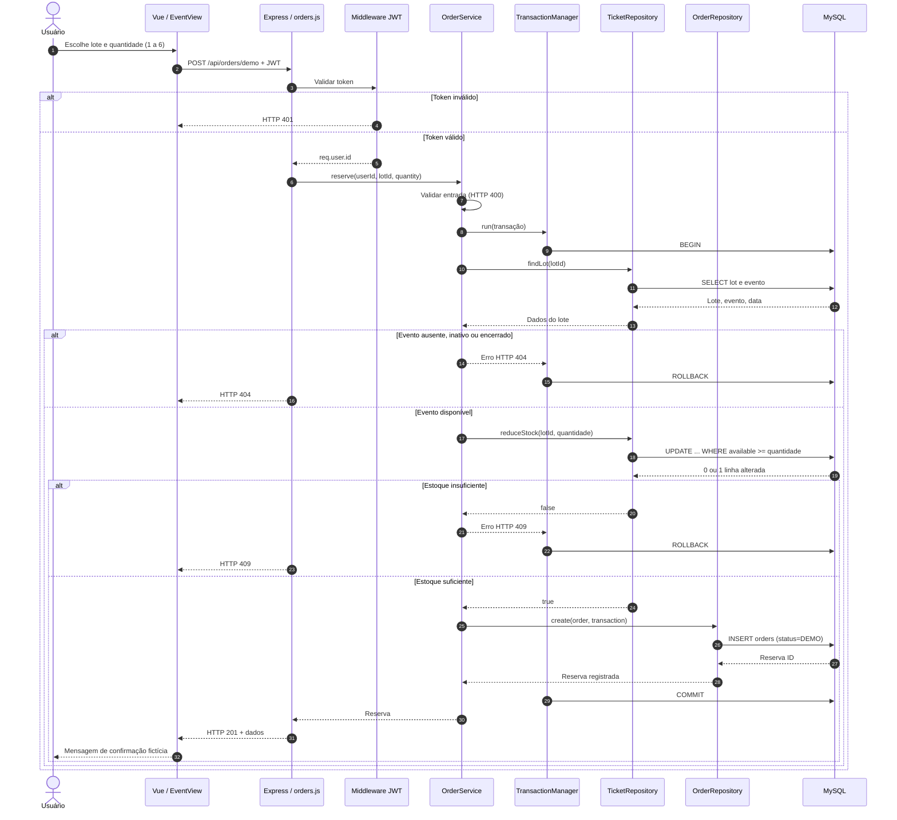
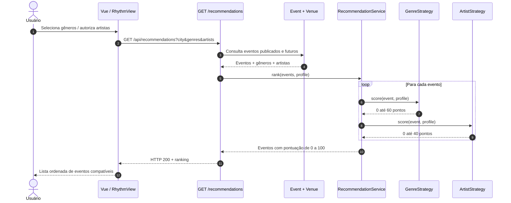

# Alfred | Diagramas de sequência (UML)

## Fluxo principal: reserva de ingressos de demonstração

O GitHub renderiza o diagrama Mermaid a seguir automaticamente quando este arquivo é aberto. Também existe uma versão PNG para colocar em slides:

## Fluxo complementar: recomendações personalizadas

### Como explicar em sala

- As **linhas verticais** representam participantes ao longo do tempo.
- As **setas** representam chamadas/respostas.
- Os blocos **alt/else** documentam o caminho de sucesso e as falhas: 400 (entrada), 401 (sem autenticação), 404 (indisponível), 409 (estoque insuficiente).
- A **transação** impede criar uma reserva sem reduzir estoque ou reduzir estoque sem criar reserva.
- O uso de **Strategy** permite adicionar outra lógica de recomendação com o mesmo contrato de pontuação.

> Todos os eventos, reservas e preços desta entrega são fictícios. Não existem pagamentos ou tickets oficiais.
