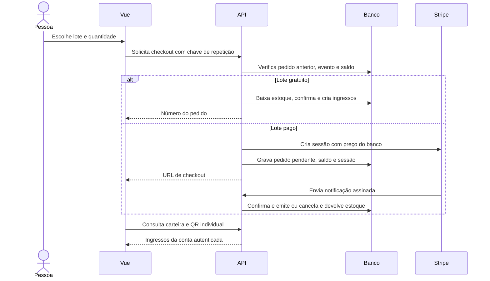

# Emissão de um ingresso

O organizador escolhe o evento e apresenta o identificador lido do QR à API. A transação bloqueia o registro, confere evento e pedido e registra o horário da primeira utilização.
